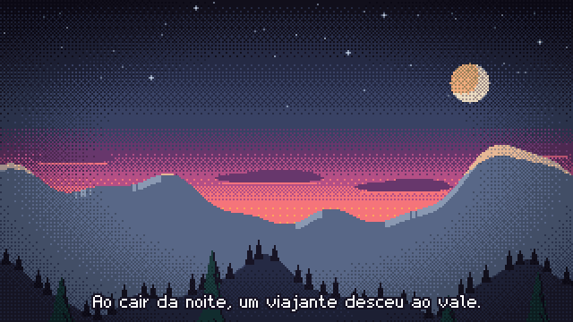
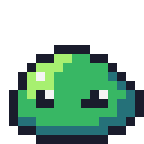
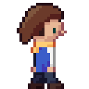
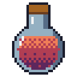
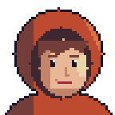
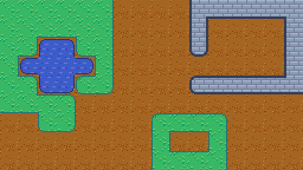
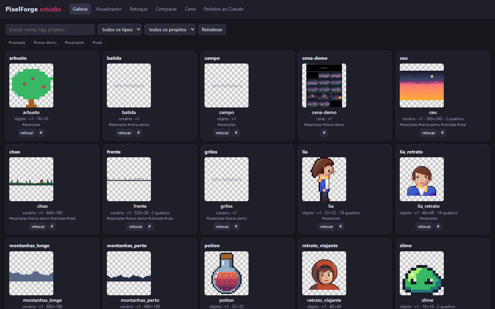
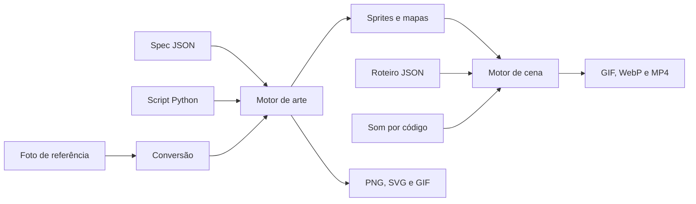

<picture>
  <source media="(prefers-color-scheme: dark)" srcset="docs/vitrine/capa-escuro.svg">
  
</picture>

Um motor de pixel art em Python. Descreva uma arte em dados ou em código, ou entregue uma foto, e ele desenha, anima, monta cenas com câmera e trilha sonora e exporta em PNG, WebP, GIF, SVG e MP4. Foi projetado para trabalhar junto com o Claude Code, que escreve os roteiros e revisa o resultado.

  

Cena de 29 segundos gerada a partir de um <a href="art/examples/cena-demo/cena-demo.json">roteiro JSON</a>: cenário em camadas, atores, diálogo, títulos e som.

## O que ele faz

| | |
|---|---|
| **Desenha** | A arte é uma grade de caracteres em JSON ou um script Python com primitivas de desenho. |
| **Converte fotos** | Encaixe na grade, redução de cores em OKLab, dithering, remoção de fundo e contorno. |
| **Cria personagens** | De uma ficha saem o sprite, o retrato, as expressões e as animações. |
| **Monta mapas** | Tilesets com autotile e mapas a partir de texto. |
| **Dirige cenas** | Parallax, câmera, atores, diálogo, efeitos, transições e legendas. |
| **Faz o som** | Efeitos chiptune, música por código e mixagem direto no vídeo. |
| **Revisa** | Um lint de pixel art que aponta problemas com coordenadas. |

## Galeria

<table align="center">
  <tr>
    <td align="center"></td>
    <td align="center"></td>
    <td align="center"></td>
    <td align="center"></td>
    <td align="center"></td>
  </tr>
  <tr>
    <td align="center">spec JSON</td>
    <td align="center">animação</td>
    <td align="center">expressões</td>
    <td align="center">script Python</td>
    <td align="center">retrato</td>
  </tr>
</table>

Mapa montado a partir de uma <a href="art/examples/vila.mapa.json">grade de caracteres</a>, com bordas escolhidas pelo autotile.

## Estúdio

Uma interface web local para ver o acervo, tocar animações, retocar pixels e comparar versões. Usa só a biblioteca padrão do Python e funciona sem internet.

## Como é por dentro

- **Arte como dados.** Uma arte é texto: dá para versionar, comparar e gerar por programa.
- **Resultado reproduzível.** Cenas são comparadas com imagens de referência a cada mudança.
- **Poucas dependências.** O núcleo usa só Pillow e numpy. Vídeo, som e imagem por IA são extras opcionais.
- **Testado.** 267 testes passando, do desenho ao áudio.

## Saiba mais

- [Manual completo](docs/manual.md): comandos, formatos e opções
- [Desenho do motor de cena](docs/specs/2026-10-21-pixelforge-cena-design.md)
- [Guia visual](docs/estilo/guia-visual.md)

## Licença

Código visível apenas para leitura. Todos os direitos reservados: não é permitido usar, copiar ou distribuir sem autorização. Veja [LICENSE](LICENSE).
